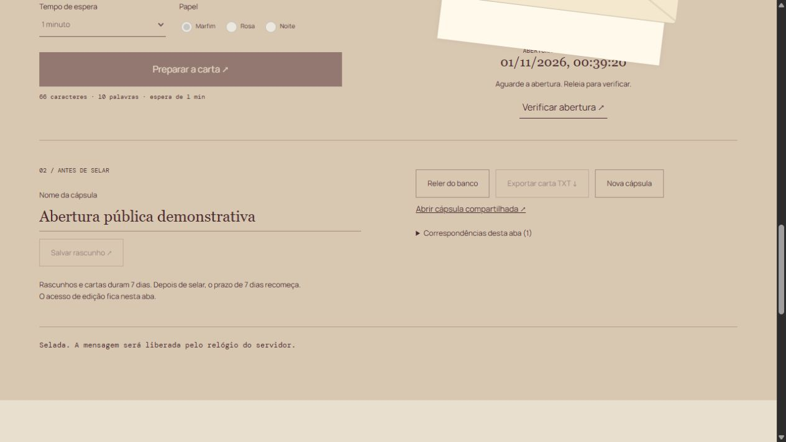

# PÓSTERA

Uma cápsula de correspondência liberada somente depois do intervalo escolhido.

[Demo gratuita](https://postera-gustapaz.starrylinen.chatgpt.site) · [API](https://postera-gustapaz.starrylinen.chatgpt.site/api-docs.html) · [Contrato integrado](docs/solution-contract.md)

## A experiência

Escrivaninha editorial, envelope em camadas e selo físico em CSS 3D. A rolagem abre o envelope introdutório; selar fecha a prévia. Três papéis: marfim, rosa e noite.

Mensagem sintética de 1–280 caracteres, espera de 60 segundos a seis dias. Selo irreversível: edição e exportação bloqueadas até o relógio do servidor autorizar. Não há criptografia ponta a ponta. Nunca escreva segredos.

Fluxo completo: alterar condições → calcular na API real → guardar no D1 → reler → compartilhar por link de leitura → exportar a revisão salva. Sem mocks substituindo o servidor. Conteúdo sintético, fotografias reais licenciadas.

## Stack

- Interface: Aurelia 2 RC e CSS 3D, bundle independente em `/experience/`.
- Domínio/API: Hattip e Superstruct.
- SSR e runtime: Vinext/Cloudflare Worker. React apenas no documento e bootstrap; a experiência usa sua própria stack após a hidratação.
- Persistência real D1, SQL parametrizado e migrações Drizzle versionadas.

[Arquitetura](docs/architecture.md) · [Design](docs/design.md) · [Segurança](docs/security.md) · [Validação](docs/validation.md)

## Executar

Node.js 24+.

```sh
npm ci
npm test
npm run typecheck
npm run check
npm run build
npm run db:migrate
npm start -- --port 59100
# Em outro terminal:
npm run smoke -- http://127.0.0.1:59100
```

Banco local em `.wrangler/state`, ignorado pelo Git. Gere novas migrações com `npm run db:generate`; não altere as já aplicadas. Hospedagem integrada declarada em `.openai/hosting.json`. Credenciais de publicação entram apenas pelo stdin do helper, nunca no código.

## Limites da demo

Sem cartão, faturamento ou trial. Runtime e D1 oferecidos pela integração Sites desta conta, sem promessa de disponibilidade ilimitada ou permanente. Retenção de 7 dias com limpeza oportunista, 12 criações por hora UTC no conjunto da demo, até 30 revisões por registro e 16 KiB por JSON. Erros explícitos, sem resultado offline inventado.

Edição autorizada por token aleatório de recurso, mantido somente na sessão desta aba. O link contém apenas o UUID e concede leitura. Exporte antes de fechar a aba; não há recuperação do token, conta ou e-mail externo.

Ao selar, o prazo de sete dias recomeça. O conteúdo está em texto no banco, mas é ocultado pela API até a abertura. Depois, qualquer pessoa com o link lê. O selo é definitivo; não escreva segredos.

## Licenças

Código original [MIT](LICENSE). Fotografias, fontes e dependências preservadas em [créditos de imagens](docs/assets-license.md), [inventário de imagens](docs/assets.json) e [licenças de dependências](docs/dependency-licenses.md). Textos distribuídos em `docs/third-party/`.


Aurelia está fixado em 2.0.0-rc.2; é uma versão release candidate.

## Experiência publicada



